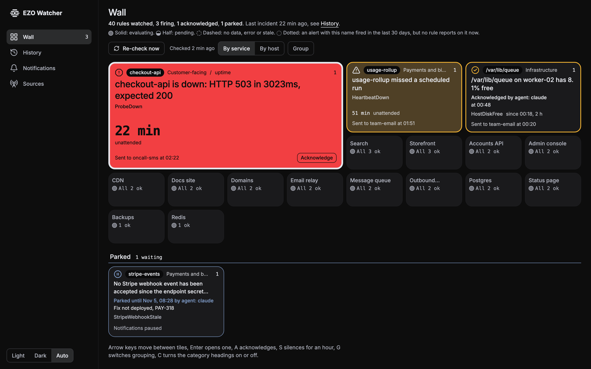
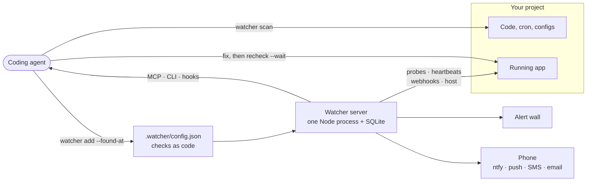
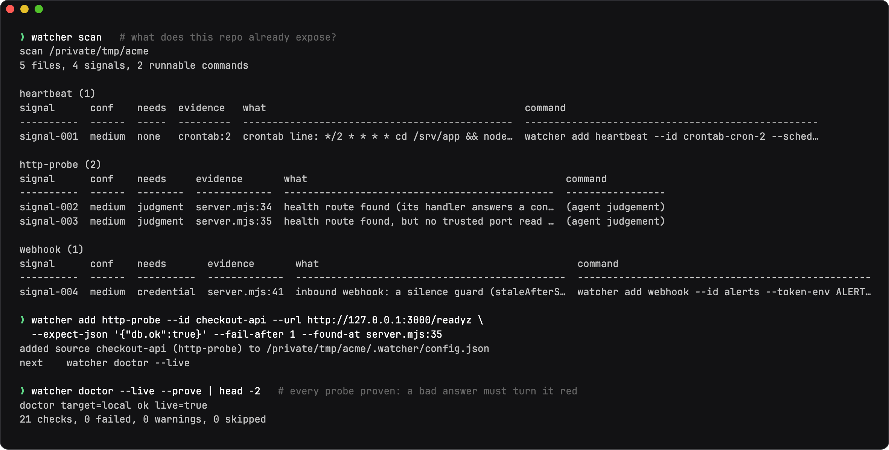
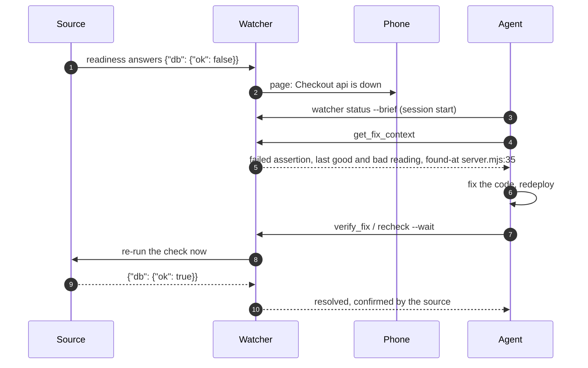
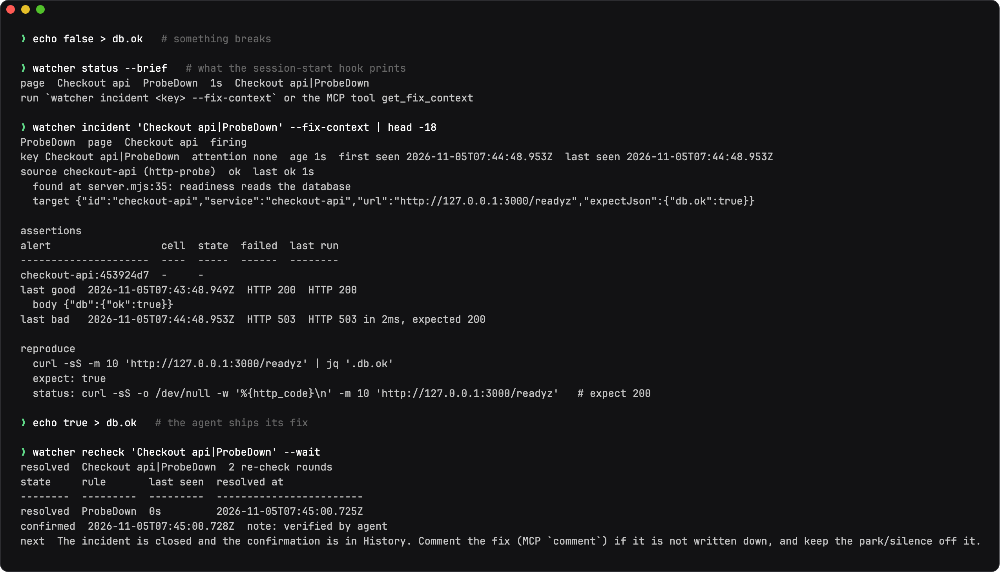
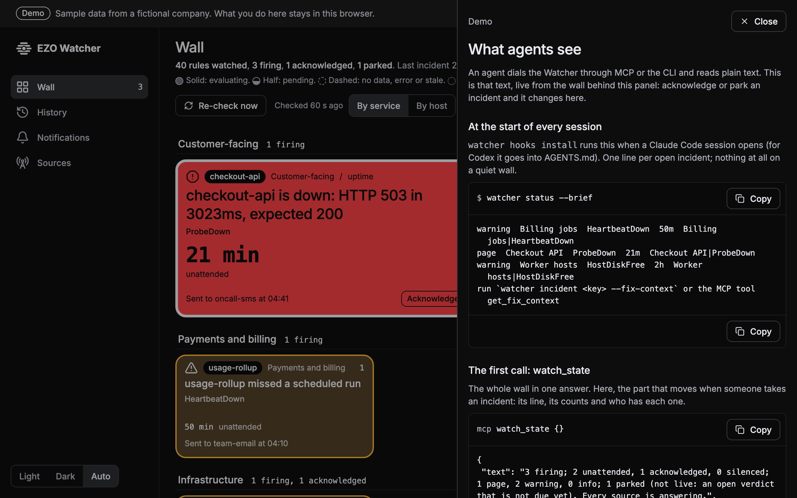
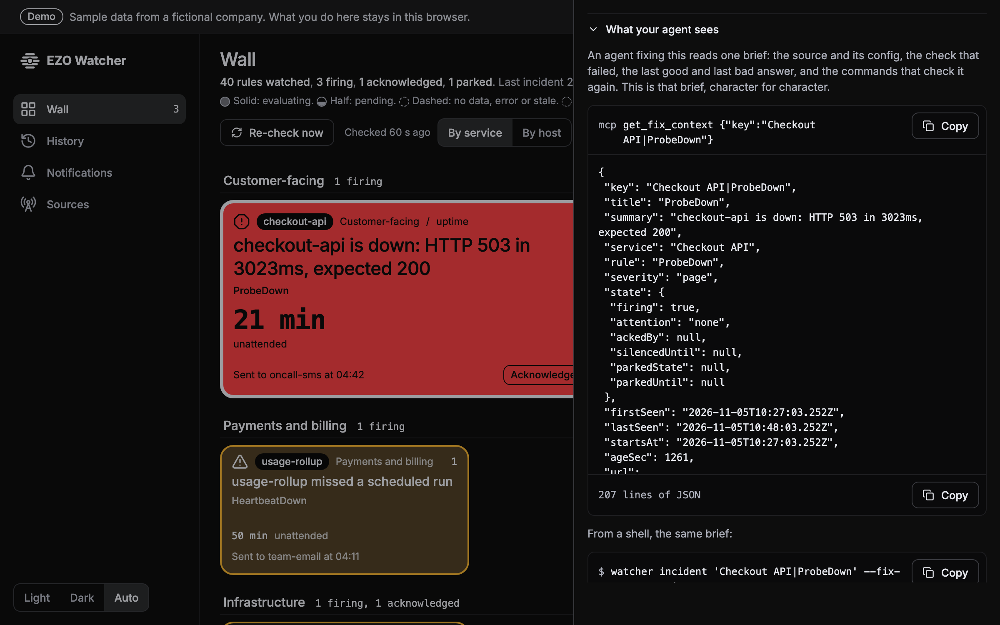
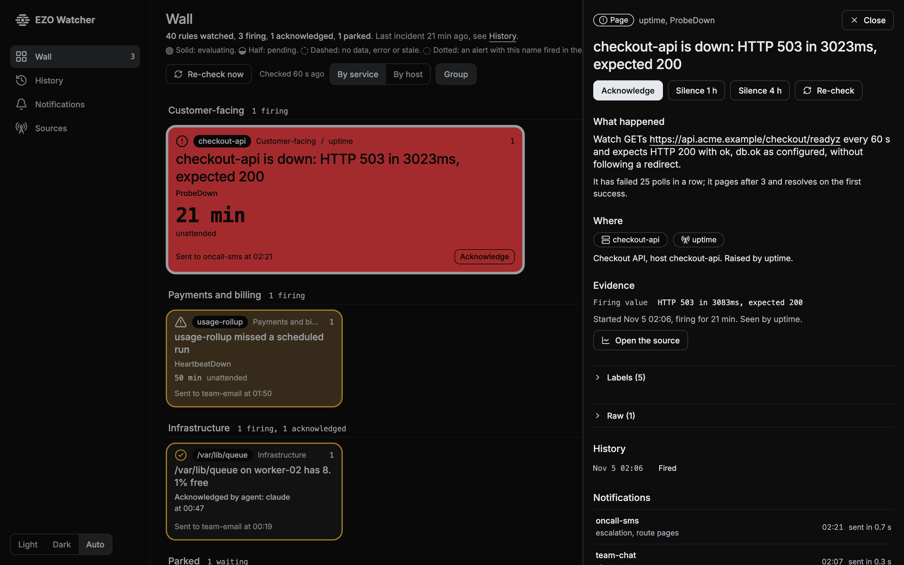
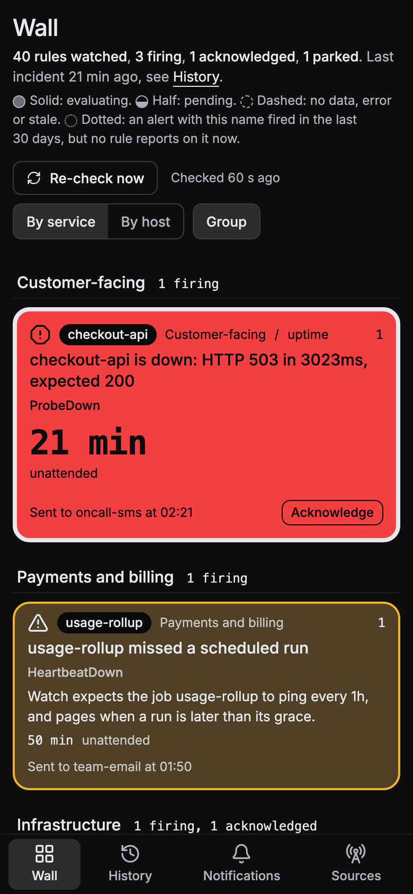
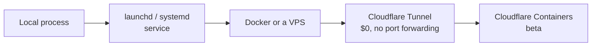

<div align="center">


# EZO Watcher

**The open-source AI SRE for your project: monitoring your coding agent installs, proves and fixes.**<br>
Agentic LiveOps monitoring: self-hosted, MCP-native, no account, and every check proven to go red before it counts.

[](https://ezo-watcher-demo.pages.dev)
[](https://www.npmjs.com/package/ezo-watcher)
[](#quickstart)
[](tsconfig.json)
[](docs/mcp.md)
[](#why-it-is-different)
[](LICENSE)
[](https://github.com/ezolabs/ezo-watcher/actions/workflows/ci.yml)

[Live demo](https://ezo-watcher-demo.pages.dev) · [Quickstart](#quickstart) · [How it works](#how-it-works) · [The fix loop](#the-fix-loop) · [What agents see](#what-agents-see) · [MCP](#mcp) · [Hosting](#hosting) · [Docs](#docs)

<br>

<picture>
  <source media="(prefers-color-scheme: light)" srcset="docs/assets/wall-light.png">
  
</picture>

</div>

<br>

A health route that answers `{"ok": true}` proves the process is up. It stays green when the database is down, the queue is stuck or last night's cron job never ran.

EZO Watcher is an alert wall and a pager for one project, built to be set up by the agent that already works on the code. The agent reads the repo, picks the telemetry points that can actually go red, adds each one with the file and line it came from, and proves it: `watcher doctor --live --prove` pushes every source's own reading past its threshold and fails the install unless the check flips. `{"ok": true, "live": true}` is the only done.

When something breaks later, the same agent reads the incident, ships a fix and closes it with a recheck. The source decides when it is well again, not the agent.

> [!TIP]
> **[Open the live demo](https://ezo-watcher-demo.pages.dev)**: a full wall with sample data. Acknowledge, silence, park and recheck incidents; your changes stay in your browser.

## How it works



1. **Scan.** `watcher scan` lists what the repo already exposes: readiness routes, cron entries, scheduled workflows, Sentry, Grafana, Netdata, published ports.
2. **Add.** The agent turns each signal into a source. Every source carries the assertion that changes when a dependency is down, plus `--found-at file:line` so an incident points straight back at the code.
3. **Prove.** `watcher doctor --live --prove` mutates each reading (a bad JSON answer, a missed heartbeat, a disk past its limit) and fails unless the check goes red.
4. **Run.** One process serves the wall, pages your phone and speaks MCP.
5. **Fix.** An incident hands the agent a fix brief. The agent ships the fix and `recheck --wait` closes the incident only when the source reads healthy.

<p align="center">
  
</p>

## Quickstart

### Give this to your agent

```text
Set up EZO Watcher for this project. Install the CLI with
`CI=1 npm_config_yes=true npm i -g ezo-watcher`, then run
`watcher init` and `watcher skills install --target all`, and follow the
ezo-watcher skill end to end (read `.claude/skills/ezo-watcher/SKILL.md` or
`.agents/skills/ezo-watcher/SKILL.md` if the skill is not listed in this session yet).

Follow its ranking: a dependency-gated readiness route first (never a route that
just returns {"ok": true}), a heartbeat for every scheduled job, then any Sentry,
Grafana or Netdata already in the project. Add one alert channel and prove it
with `watcher test-alert`.

Do not stop until `watcher doctor --live --prove --json` prints
{"ok": true, "live": true}. If this project has no server and no scheduled job,
add `watcher add host --id host` — the machine itself, read locally with nothing
installed (load, memory, free space, optionally a pid file) — and prove it. Only
if there is no server, no scheduled job and no host to watch either, run
`watcher doctor --no-runtime-surface --json` and tell me instead; a configured
source always wins over `--no-runtime-surface`. Ask me only
for the credential a chosen source or channel needs, and tell me what you watched
and what you skipped.
```

Claude Code users: after `watcher skills install`, run `/reload-skills` so the new skill is picked up in that session.

### Or by hand

```bash
# Node 24+.
npm i -g ezo-watcher
watcher --version

cd my-project
watcher init
watcher scan --json
watcher add http-probe --id app --url http://127.0.0.1:3000/readyz \
  --expect-json '{"db.ok":true}' --found-at src/server.ts:42 \
  --read "readiness reads the database"
watcher add channel ntfy --id ntfy --server https://ntfy.sh --topic-env WATCHER_NTFY_TOPIC
# or, with no credential at all: watcher add channel file --id local
watcher run --detach
watcher doctor --live --prove --json    # {"ok": true, "live": true}
watcher test-alert
```

No global install: `npx -y ezo-watcher <verb>` runs any verb the same way (`npx -y ezo-watcher init`). Open `http://127.0.0.1:7717` for the wall. `watcher init` writes `.watcher/config.json` (commit it), `.watcher/.env` and `.watcher/data/` (gitignored), and picks a free port from 7717.

## What it sets up

| The project has | EZO Watcher adds |
| --- | --- |
| A server with a readiness route | An `http-probe` asserting the JSON field that changes when a dependency is down, not the status code alone |
| A scheduled job, cron, timer, workflow or worker loop | A `heartbeat` per job: a missed run is an incident, not silence |
| A database, cache or published port | A `tcp-probe` (with TLS expiry when the socket is TLS) |
| Sentry, Grafana, Netdata | Their own sources: read what already exists instead of duplicating it |
| An inbound sender (Stripe, GitHub, a collector) | A `webhook` source with a staleness window, so a sender that stops is a page |
| A domain | `domain-expiry` over RDAP, beside the certificate expiry `http-probe` already reads |
| A machine with nothing installed on it | A `host` source: load per core, memory available, free space per mount and optionally one pid file, read locally |
| A phone that must ring | One channel: ntfy, web push, SMS, email or a webhook, proven with `watcher test-alert`. No credential? The `file` channel records every notification as JSONL and needs none |

## The fix loop

Once the Watcher is running, the prompt is one line:

```text
Check the Watcher for open incidents and fix them; verify each fix with a recheck.
```



<p align="center">
  
</p>

The agent drives `watcher status --brief` for one line at session start, then `get_fix_context` (or `watcher incident <key> --fix-context`) for the incident's own brief: the source and target config, the assertion that failed, the last good and last bad observation, and the command that re-runs the check. After the fix and a redeploy, `verify_fix` (or `watcher recheck <key> --wait`) closes the incident with the attribution only when the source itself says it is well again. The full loop is `watcher skills fix`.

<details>
<summary><b>Brief the agent at every session start</b></summary>

```bash
watcher hooks install --target claude     # SessionStart: watcher status --brief
```

It writes the `SessionStart` hook into the project's `.claude/settings.json`, so a session that opens finds the wall's state in one line without asking. `--target codex` writes the same instruction into `AGENTS.md` instead (`watcher hooks uninstall` takes it back out).

</details>

<details>
<summary><b>Page when the agent itself stops working</b></summary>

Add one heartbeat (its ping token is generated into `.watcher/.env` for you) and a `Stop` hook that pings it after every turn:

```bash
watcher add heartbeat --id agent-session --every 30m --grace 15m \
  --token-env WATCHER_AGENT_SESSION_TOKEN
```

```json
{
  "hooks": {
    "Stop": [
      { "hooks": [
        { "type": "command",
          "command": "sh -c 'set -a; . .watcher/.env 2>/dev/null; curl -fsS -X POST -H \"Authorization: Bearer $WATCHER_AGENT_SESSION_TOKEN\" http://127.0.0.1:7717/ingest/heartbeat/agent-session >/dev/null 2>&1 || true'" }
      ] }
    ]
  }
}
```

Any turn inside the grace keeps the heartbeat green; when the agent stops working for longer than that, `HeartbeatDown` pages. The `|| true` keeps a stopped Watcher from blocking the agent's turn. ([Claude Code hooks reference](https://code.claude.com/docs/en/hooks), read 2026-11-04.)

</details>

## What agents see

An agent dials the Watcher through MCP (`/mcp`) or the CLI and reads plain text. The [demo](https://ezo-watcher-demo.pages.dev/#/agents) shows it live: acknowledge or park an incident and every answer below changes. Every incident sheet has the same view under **What your agent sees**.



At the start of every session, `watcher hooks install` runs `watcher status --brief`: one line per open incident, nothing on a quiet wall.

```
$ watcher status --brief
warning  Billing jobs  HeartbeatDown  50m  Billing jobs|HeartbeatDown
page  Checkout API  ProbeDown  21m  Checkout API|ProbeDown
warning  Worker hosts  HostDiskFree  2h  Worker hosts|HostDiskFree
run `watcher incident <key> --fix-context` or the MCP tool get_fix_context
```

The first MCP call, `watch_state`, is the wall in one answer (excerpt):

```json
{
 "text": "3 firing; 2 unattended, 1 acknowledged, 0 silenced; 1 page, 2 warning, 0 info; 1 parked (not live: an open verdict that is not due yet). Every source is answering.",
 "counts": { "firing": 3, "unattended": 2, "acknowledged": 1, "silenced": 0, "parked": 1, "page": 1, "warning": 2, "info": 0 }
}
```

Then `get_fix_context {"key":"Checkout API|ProbeDown"}` (or `watcher incident 'Checkout API|ProbeDown' --fix-context --json`) returns everything needed to fix it without asking a person (cut here; the real brief is about 200 lines):

```jsonc
{
 "key": "Checkout API|ProbeDown",
 "summary": "checkout-api is down: HTTP 503 in 3023ms, expected 200",
 "state": { "firing": true, "attention": "none", "ackedBy": null, "silencedUntil": null, "parkedState": null, "parkedUntil": null },
 // sources[0].target: the config that failed
 "target": { "id": "checkout-api", "url": "https://api.acme.example/checkout/readyz", "expectJson": { "ok": true, "db.ok": true }, "slowMs": 800 },
 "asserts": [{ "asserts": ["status 200", "body.ok = true", "body.db.ok = true"], "failed": ["status 200"],
   "failureDetail": "HTTP 503 in 3023ms, expected 200 (25 failed polls in a row)" }],
 "observations": {
  "lastGood": { "at": "2026-11-05T15:06:00.000Z", "status": 200, "body": "{\"ok\":true,\"db\":{\"ok\":true,\"poolInUse\":8}}" },
  "lastBad": { "at": "2026-11-05T15:30:00.000Z", "status": 503, "detail": "HTTP 503 in 3023ms, expected 200" }
 },
 "reproduce": {
  "command": "curl -sS -m 10 'https://api.acme.example/checkout/readyz' | jq '.ok'", "expect": "true",
  "watcher": "watcher recheck 'Checkout API|ProbeDown' --wait --json"
 },
 "next": [{ "action": "fix" }, { "action": "restart-or-deploy" }, { "action": "verify" }]  // each with its detail
}
```



## The wall

<table>
  <tr>
    <td width="74%"></td>
    <td width="26%"></td>
  </tr>
  <tr>
    <td align="center"><sub>Every incident opens a sheet: what failed, the evidence, its history and every notification sent.</sub></td>
    <td align="center"><sub>Same wall on a phone, installable as a PWA with web push.</sub></td>
  </tr>
</table>

Firing tiles take the room; healthy services shrink to a dense grid. A page is red, a warning is amber, an acknowledged incident shows who took it, and a parked one gets its own colour and expires on its own. The look follows ISA-101 high-performance HMI practice: grey by default, colour only for what needs attention ([docs/design.md](docs/design.md)).

## MCP

Two forms, stdio first:

```bash
watcher mcp-config --client claude     # also: cursor, codex; --show-secret prints the token
```

The stdio form registers the running CLI itself (`node <the install's bin/watcher.mjs> mcp --dir <project>`): the client starts a small bridge in the project, the bridge reads `WATCHER_MCP_TOKEN` from `.watcher/.env`, and no secret is in the registration. Use it for an agent on the same machine as the Watcher.

The HTTP form is the running server's own endpoint, `<baseUrl>/mcp` (Streamable HTTP, stateless) behind `Authorization: Bearer $WATCHER_MCP_TOKEN`. Use it behind your Tunnel so the same agent can work from anywhere the tunnel reaches; put a Cloudflare Access bypass on `/mcp` if Access is on (the endpoint keeps its own bearer token; see `watcher skills cloudflare`).

| Reads | Writes (each as `agent: <who>`) |
| --- | --- |
| `watch_state` · `list_incidents` · `get_incident` · `get_fix_context` · `incident_history` · `list_sources` | `acknowledge` · `unacknowledge` · `silence` · `park` · `unpark` · `comment` · `recheck` · `verify_fix` · `resolve` · `confirm_resolution` |

Every input is in [docs/mcp.md](docs/mcp.md).

## Why it is different

- **Assertion-proven, not status-proven.** A 200 proves a socket accepted a connection. The install is green only when each check carries a predicate that flips under mutation (`--prove`), so a broken database, a stalled queue or a dead job actually pages.
- **Silence-first.** In a prototype scan of four hand-labelled repositories, a file scan found most of the HTTP surface but only about a fifth of the silence: schedules generated inside install scripts, launchd/systemd units created at runtime, pull-queue workers, staleness declared in the product's own config, state-dir writability, dependency URLs held as code constants. The skill ships that checklist, and each item becomes a heartbeat or a webhook with a stale window.
- **Local and account-free.** One Node process, `node:sqlite`, config in your git, secrets in a 0600 env file. Nothing to sign up for; it runs on a laptop, a server or behind a Cloudflare Tunnel.
- **Agent-native.** The docs ship inside the CLI (`watcher skills <topic>`), the install loop is written for an agent, and the running Watcher speaks MCP so an agent can read the wall, acknowledge, comment, silence, park and recheck as itself.

## Hosting



Cheapest first. **Cloudflare Tunnel** is the default for "host it with my Cloudflare key": a hostname on a zone you already have, no port forwarding. `watcher cloudflare tunnel --hostname watch.example.com` does the tunnel, DNS and run token; `watcher cloudflare quick` gives an ephemeral public URL for a demo. Cloudflare Containers runs about $9.57/month kept awake and cannot probe your LAN; a Workers edge port is not built yet. Details: `watcher skills hosting` and `watcher skills cloudflare`.

Binding off loopback requires `WATCHER_ADMIN_TOKEN`; the server refuses to start without it.

## Docs

| | |
| --- | --- |
| [`skills/ezo-watcher/SKILL.md`](skills/ezo-watcher/SKILL.md) | The install loop. Also printed by the CLI: `watcher skills` lists topics (`install`, `discover`, `sources`, `channels`, `hosting`, `cloudflare`, `netdata`, `operate`, `fix`, `telemetry`) |
| [`skills/ezo-watcher/references/`](skills/ezo-watcher/references/) | The detail those topics print |
| [`docs/mcp.md`](docs/mcp.md) | Connect an agent to the running wall |
| [`docs/doctor-codes.md`](docs/doctor-codes.md) | Every `watcher doctor` code and its fix |
| [`docs/embed.md`](docs/embed.md) | Embed the wall or one tile in another page |
| [`docs/telemetry.md`](docs/telemetry.md) | What anonymous telemetry sends, and how to turn it off |
| [`docs/design.md`](docs/design.md) | The product and visual decisions, with sources |
| [`AGENTS.md`](AGENTS.md) | How to work on this repository |
| [`llms.txt`](llms.txt) | The index for an agent reading the repo |

## Telemetry

The CLI and the server send anonymous usage data (the verb and flag names, exit codes, `doctor` check codes, internal error types) so we can find failures and fix them first. Never paths, hosts, URLs, config or env values. It is on after a one-time notice; turn it off with `watcher telemetry disable` or `DO_NOT_TRACK=1`, and `WATCHER_TELEMETRY_DEBUG=1` prints exactly what would be sent. What is sent and where it goes: [docs/telemetry.md](docs/telemetry.md).

## Status

Public preview, published on npm as [`ezo-watcher`](https://www.npmjs.com/package/ezo-watcher). Hosting the wall for someone else's project is supported; multi-tenant hosting is not.

## Develop

```bash
npm ci
npm run build
npm run typecheck
npm test
```

Node 24+, ESM, TypeScript. See [`AGENTS.md`](AGENTS.md) for the layout, the test rules and the leak gate, and [`docs/design.md`](docs/design.md) for the product decisions.

## License

[MIT](LICENSE) © EZO Labs Inc.
